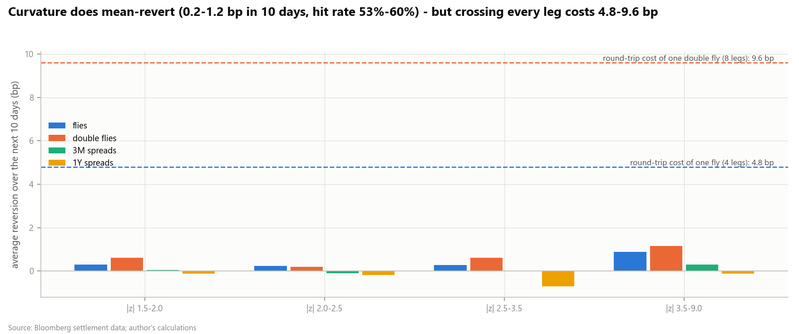
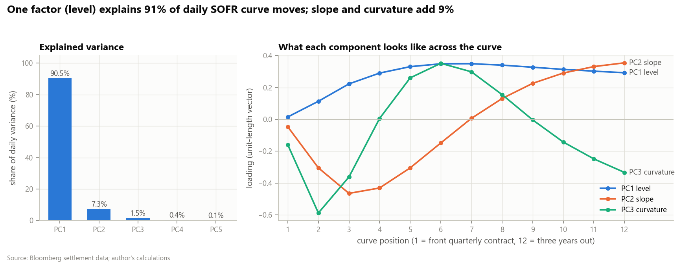
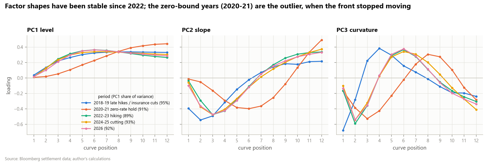
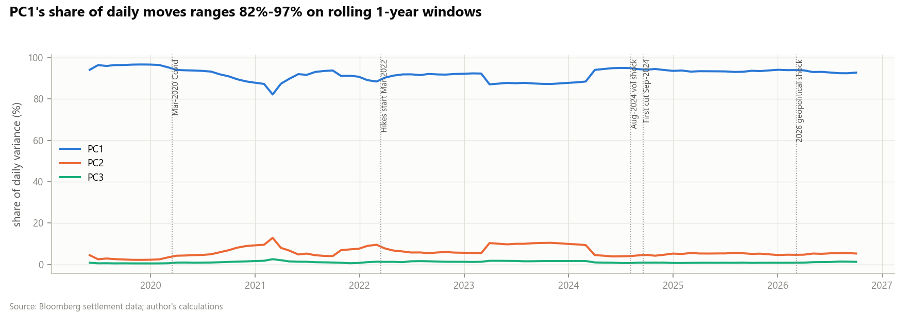
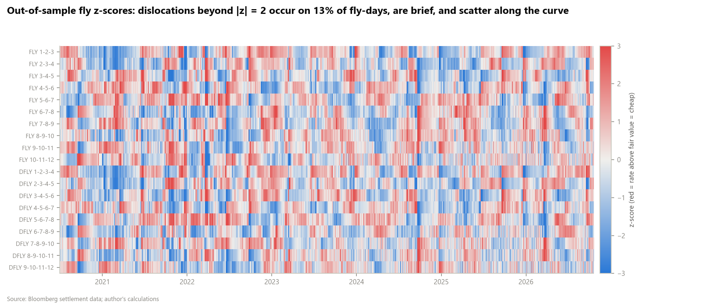
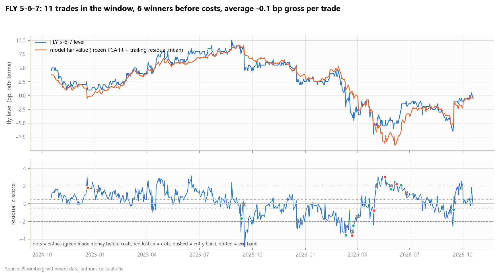
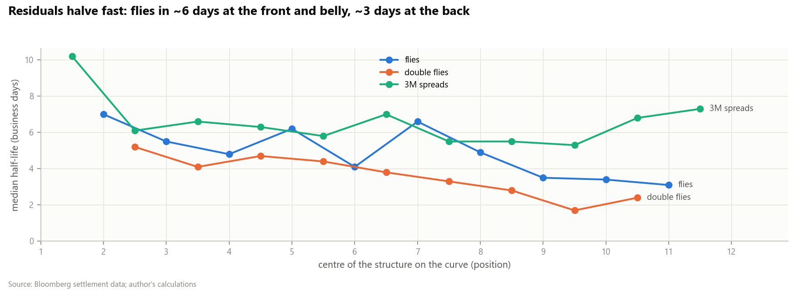
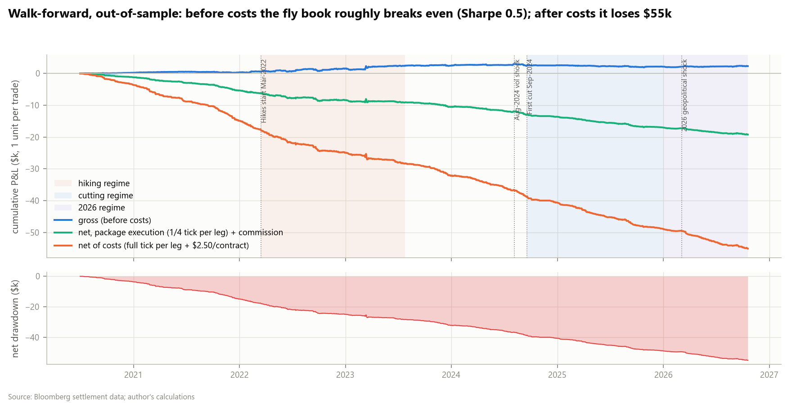
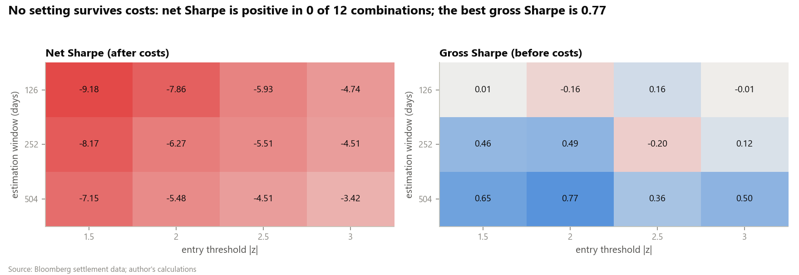
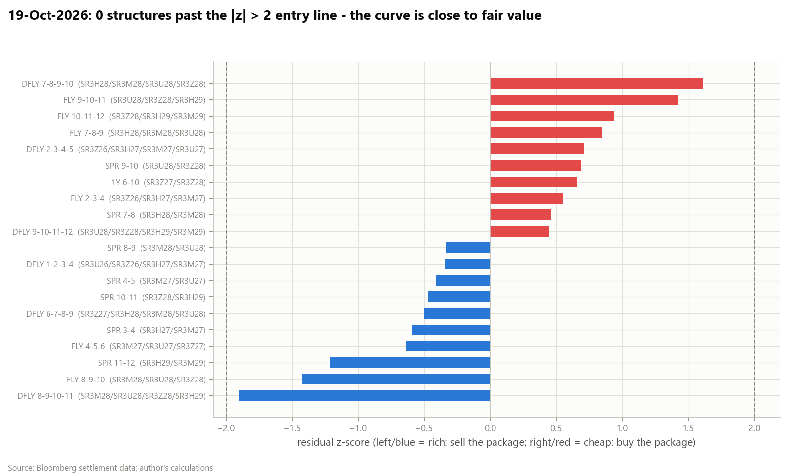

# SOFR Curve PCA & Butterfly Mean-Reversion

**Which SOFR spreads and butterflies are rich or cheap relative to the curve's normal shape - and does trading them
back to fair value make money after costs, out of sample?** A study for STIR relative-value traders, on eight years of
SR3 settlement data (Jun-2018 to Oct-2026).

**[Interactive report (hover any chart)](https://atharvadeshpande002.github.io/sofr-curve-pca-rv/reports/report.html)** ·
[Walkthrough notebook](notebooks/walkthrough.ipynb) · [Interview notes](INTERVIEW_NOTES.md)

---

## Key findings

* **Three shapes explain 99.3% of daily curve moves.** Level 90.5%, slope 7.3%, curvature 1.5% (PCA of daily changes
  on positions 1-12). The shapes have been stable since 2022; the zero-rate years (2020-21) are the outlier.
* **Curvature mean-reverts; spreads don't.** Out of sample, flies and double flies move back toward fair value by
  **0.2-1.2 bp over the next 10 days** after a signal, with **53-60% hit rates**. 3M and 1Y spreads show no reversion
  (hit rates 47-50%). Residual half-lives are short: **3-7 days** for flies.
* **The edge is real but smaller than the cost of trading it.** Walk-forward, Jul-2020 to Oct-2026, the fly and
  double-fly book made **361 trades, +0.25 bp gross per trade (gross Sharpe 0.49)** and **lost $55k net (Sharpe -6.3)**
  after paying one tick per leg per side plus $2.50 per contract. Break-even cost is **0.036 bp per contract per side
  (~$0.90)** - below commission alone.
* **Nothing rescues it.** Net Sharpe is negative in **all 12** window x entry-threshold combinations, in every policy
  regime, under four exit rules and under cheaper "package" execution. In-sample the same rules look better
  (gross Sharpe 0.89, +0.70 bp per trade) - the usual decay once the model has to work on data it has not seen.
* **PCA-neutral flies remove level/slope risk but are not more mean-reverting.** Their PC1/PC2 betas fall to zero, yet
  their levels revert *more slowly* than 1:-2:1 (e.g. the 5-6-7 fly: half-life 40 days -> 178 days). Part of the
  textbook fly's "mean reversion" is a small, mean-reverting level exposure.

## The answer in one picture



## Why this matters on a desk

* **Do not pay the offer on every leg to trade fly residuals.** At 4 legs (fly) or 8 legs (double fly), the round-trip
  cost of crossing (4.8 / 9.6 bp) is roughly 5 to 50 times the average 10-day reversion.
* **Do use it to time trades you already want.** If you like a fly for macro reasons, the residual z-score tells you
  whether you are buying it on the cheap or rich side of its curve-implied value, and the half-life tells you how long
  that usually lasts (days, not weeks).
* **Size hedges with PCA weights** when the goal is to isolate curvature from level and slope moves - but do not expect
  them to make the residual itself better behaved.
* **Watch the rare |z| > 3.5 dislocations**: reversion there is ~1 bp in 10 days, still too small for leg-by-leg
  execution, but worth knowing if you can work passive orders or trade the listed package.

## Method

| Step | What | Rule / formula |
|---|---|---|
| 1. Curve | Constant positions 1-12 = next 12 quarterly SR3 contracts | rate (bp) = (100 - price) x 100; position 1 = first quarterly contract with last trade >= today |
| | Roll-safe daily changes | change of each **fixed** contract, then mapped to today's position - a roll never creates a move |
| | Structures (rate terms, front minus back) | 3M spread r(i)-r(i+1); 1Y spread r(i)-r(i+4); fly r(i)-2r(i+1)+r(i+2); double fly r(i)-3r(i+1)+3r(i+2)-r(i+3) |
| 2. PCA | Eigen-decomposition of the covariance of daily changes | 252-day window (126 / 504 tested); signs fixed: PC1 all up, PC2 steepener, PC3 belly up |
| 3. Rich/cheap | Regress each structure's level on PC1-PC3 level scores | y = a + b.s + e; z = (e - trailing 63-day mean of e) / trailing std |
| | PCA-neutral weights | keep inner legs (-2, or -3/+3), solve the wings for zero PC1 and PC2 exposure |
| 4. Mean reversion | AR(1) on the residual; ADF test | half-life = -ln 2 / ln(phi) |
| 5. Backtest | Walk-forward: fit on the last 252 days, trade the next 63 frozen, refit | enter 2 < abs(z) < 3.5; exit abs(z) < 0.5; stop abs(z) > 3.5; time stop 2 x half-life (max 60 days) |
| | Execution | signal at the close of t, trade at the settle of t+1; trades held on fixed contracts through rolls; closed on a leg's last trading day |
| | Overlap control | max 2 open trades per curve region (front / belly / back); no two open trades share a contract |
| | Costs (`config.yaml`) | 1 tick = 0.5 bp per leg per side + $2.50 per contract per side; 1 bp = $25 per contract |

## Results

All backtest numbers are out-of-sample (Jul-2020 to Oct-2026, 1,587 sessions) unless labelled in-sample. One unit per trade.

**Headline - fly and double-fly book**

| | trades | avg gross / trade | gross Sharpe | net P&L | net Sharpe | max drawdown |
|---|---:|---:|---:|---:|---:|---:|
| Out-of-sample (walk-forward) | 361 | +0.25 bp | 0.49 | -$55,060 | -6.27 | -$55,060 |
| In-sample (one fit on all data) | 245 | +0.70 bp | 0.89 | -$36,986 | -5.16 | -$36,986 |

**By family** (same rule, each family run on its own)

| family | trades | gross hit rate | avg gross / trade | gross Sharpe | net P&L |
|---|---:|---:|---:|---:|---:|
| fly | 318 | 44% | +0.19 bp | 0.35 | -$36,666 |
| double fly | 267 | 48% | +0.38 bp | 0.68 | -$61,524 |
| 3M spread | 377 | 45% | -0.22 bp | -0.33 | -$24,726 |
| 1Y spread | 259 | 49% | +0.45 bp | 0.22 | -$12,621 |

**Cost sensitivity** (same trades re-priced)

| execution assumption | net P&L | net Sharpe |
|---|---:|---:|
| no costs at all | +$2,300 | 0.49 |
| commission only ($2.50/contract/side) | -$7,260 | -1.45 |
| package execution (1/4 tick per leg) | -$19,210 | -3.40 |
| half tick per leg | -$31,160 | -4.75 |
| full tick per leg (default) | -$55,060 | -6.27 |

**Rule variants** (no cherry-picking: all reported) - net Sharpe -6.27 (spec rule), -6.13 (exit at z = 0),
-5.87 (no stop-loss), -5.21 (fixed 10-day hold). **By regime** - net Sharpe -3.97 hiking, -7.47 cutting,
-7.73 hold, -7.12 in 2026.

| | |
|---|---|
|  |  |
|  |  |
|  |  |
|  |  |

**Today's screen** (19-Oct-2026): no structure is beyond the |z| > 2 entry line; the nearest is the
8-9-10-11 double fly (SR3M28/U28/Z28/H29) at z = -1.90 (rich).



Every table above is a CSV in [`reports/results/`](reports/results) and `summary.json` holds the headline numbers.

## Limitations & honest caveats

* **Daily settles only.** Entry and exit at settlement prices; no intraday timing, no bid-offer history. The cost model
  is an assumption, stated in `config.yaml` and varied above.
* **Leg-by-leg costs are conservative for flies.** Listed butterfly packages can trade tighter than four legs crossed
  separately - but even "commission only" loses money, so the conclusion does not depend on the tick assumption.
* **Constant position, not constant maturity.** Position k shifts by three months at each roll; the residual history of
  "the 5-6-7 fly" spans different contracts. Trades themselves are always on fixed contracts.
* **Short history.** SR3 listed in 2018; the out-of-sample period (2020-2026) holds one hiking and one cutting cycle,
  the zero-rate years and 2026. Pre-2018 Eurodollar history was deliberately not spliced in.
* **The signal-quality t-stats are approximate**: overlapping horizons and correlated neighbouring structures inflate
  them.
* **What didn't work:** spreads (no reversion), PCA-neutral weighting (cleaner hedge, not a cleaner signal), tighter
  or looser entry thresholds, longer or shorter windows, removing the stop or holding to z = 0.

## How to run

```bash
pip install -r requirements.txt
# put sr3_settles.csv and sr3_contracts.csv in data/raw/  (format: data/README.md)
python scripts/run_all.py          # all results, charts, report.html and the executed notebook (~1 min)
python scripts/screen_today.py     # today's top rich / cheap structures with targets and stops
pytest                             # roll handling, no look-ahead, structure and cost maths, hand spot-checks
```

Every parameter (dates, windows, thresholds, costs, regimes, events) is in [`config.yaml`](config.yaml).

```
src/sofr_pca/   config.py  data.py  structures.py  pca.py  residuals.py  meanrev.py
                backtest.py  analysis.py  screen.py  plots.py
scripts/        run_all.py  screen_today.py  build_notebook.py
tests/          test_rolls.py  test_no_lookahead.py  test_structures_and_costs.py  test_models.py  test_spot_checks.py
reports/        report.html  figures/*.png  results/*.csv
```

## Next steps

1. **Passive execution model**: simulate resting orders at the package bid/offer - the only route where a 0.25-1 bp
   edge can survive.
2. **Sharper signals**: condition on open-interest changes, event days (CPI, payrolls, FOMC) and the residual's own
   speed of reversion; drop structures whose half-life is unstable.
3. **Intraday data** to measure the reversion that happens within the day of the dislocation.
4. **Extend the curve** to positions 13-16 and to SR1 / ZQ for the front end.

---
Source: Bloomberg settlement data; author's calculations. Research project; not investment advice.
